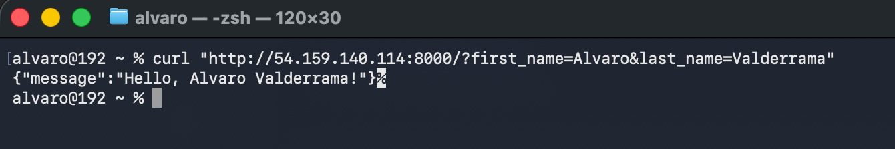
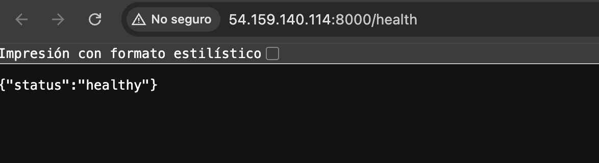
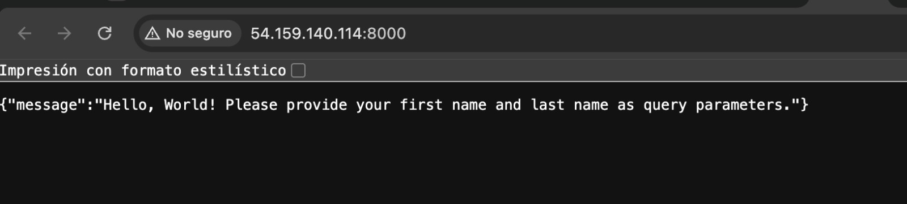

# Lab 1: CI/CD con GitHub Actions y Amazon ECS

## 1. Objetivo

Implementar un pipeline de integración y despliegue continuo (CI/CD) para una API REST desarrollada con Python y FastAPI. El pipeline automatiza el análisis estático del código, las pruebas unitarias, la construcción y publicación de una imagen Docker en Amazon ECR y el despliegue de la aplicación en Amazon ECS sobre instancias EC2.

Además, se creó un workflow manual para eliminar la infraestructura del laboratorio y evitar costos o consumo innecesario de recursos.

## 2. Arquitectura de la solución

La solución implementada utiliza los siguientes componentes:

- **GitHub:** repositorio del código fuente y definición de los workflows de GitHub Actions.
- **GitHub Actions:** ejecuta las etapas de validación, construcción, publicación y despliegue.
- **Pylint:** analiza estáticamente el código Python.
- **Pytest:** ejecuta las pruebas automatizadas.
- **Docker:** empaqueta la aplicación y sus dependencias en una imagen de contenedor.
- **Amazon ECR (Elastic Container Registry):** almacena las imágenes Docker publicadas por el pipeline.
- **Amazon ECS (Elastic Container Service):** administra la ejecución de la aplicación en un clúster.
- **Amazon EC2:** proporciona las instancias de cómputo donde se ejecutan los contenedores.
- **Auto Scaling Group:** administra la capacidad de las instancias EC2 asociadas al entorno.
- **Endpoint `/health`:** permite comprobar el estado de salud de la API.

### Flujo de CI/CD

1. Un cambio enviado a la rama `main` inicia el workflow de CI/CD.
2. Los jobs `lint` y `test` validan el código y ejecutan las pruebas.
3. Cuando las validaciones requeridas terminan correctamente, `build_and_push` construye la imagen Docker y la publica en ECR.
4. El job `deploy` ejecuta `scripts/deploy.sh` para desplegar la versión publicada en ECS.
5. La API queda disponible a través de la instancia EC2 y el puerto `8000`.

El pipeline también puede iniciarse manualmente desde GitHub Actions. Las credenciales de AWS se configuran mediante GitHub Secrets y el sufijo de estudiante y la región se leen desde las variables del repositorio.

## 3. Conceptos de CI/CD aplicados

- **Integración continua (CI):** cada cambio se valida mediante análisis estático y pruebas automatizadas.
- **Entrega y despliegue continuo (CD):** después de superar las validaciones, se construye y publica la imagen de la aplicación y se ejecuta el despliegue.
- **Lint:** Pylint ayuda a detectar problemas de estilo y posibles errores en el código.
- **Pruebas automatizadas:** Pytest ejecuta las pruebas del proyecto para validar su comportamiento.
- **Construcción reproducible:** Docker empaqueta la aplicación y sus dependencias en una imagen versionada con el SHA del commit; también se publica la etiqueta `latest`.
- **Registro de contenedores:** ECR almacena las imágenes que consume el entorno ECS.
- **Orquestación:** ECS administra la tarea de la aplicación, mientras que EC2 proporciona la capacidad de cómputo.
- **Automatización operativa:** los scripts `scripts/deploy.sh` y `scripts/destroy.sh` automatizan el despliegue y la limpieza de recursos desde workflows.
- **Gestión de secretos:** las credenciales de AWS se guardan como secretos del repositorio y no deben escribirse directamente en el código.

## 4. Evidencias de ejecución

Se dejan las evidencias con capturas en la carpeta `docs/evidencias/` del repositorio.
### 4.1. Pipeline de CI/CD

El workflow `CI/CD Pipeline (Lab 1)` finalizó correctamente. En la captura general se observa la ejecución exitosa en la rama `main`.


Incluye también una captura de detalle donde se vean los jobs `lint`, `test`, `build_and_push` y `deploy` completados correctamente.

### 4.2. Prueba del endpoint principal

Se realizó una petición HTTP a la IP pública de la instancia EC2, enviando los parámetros `first_name` y `last_name`. La API devolvió el saludo esperado.

Petición ejecutada:

```bash
curl "http://54.159.140.114:8000/?first_name=Alvaro&last_name=Valderrama"
```

Respuesta obtenida:

```json
{"message":"Hello, Alvaro Valderrama!"}
```



### 4.3. Prueba del endpoint de salud

Se consultó el endpoint `/health` y la API respondió con el estado `healthy`.

Petición:

```text
http://54.159.140.114:8000/health
```

Respuesta obtenida:

```json
{"status":"healthy"}
```



### 4.4. Respuesta de la raíz sin parámetros

También se verificó el comportamiento de la ruta raíz sin parámetros. La API indicó que se deben proporcionar el nombre y el apellido mediante parámetros de consulta.



### 4.5. Workflow manual de limpieza

El workflow `Cleanup Student Infrastructure` finalizó correctamente. Posteriormente, se verificó en la consola de AWS que los recursos asociados al laboratorio habían sido eliminados.


## 5. Limpieza de recursos

Para evitar dejar recursos activos después de la práctica, se implementó el workflow manual `Cleanup Student Infrastructure`, que ejecuta `scripts/destroy.sh`.

El workflow se inicia bajo demanda desde **GitHub Actions → Cleanup Student Infrastructure → Run workflow**. Después de ejecutarlo, se verificó en AWS la eliminación de los recursos del laboratorio.

La limpieza se ejecutó después de realizar las pruebas HTTP y guardar las evidencias del despliegue.

## 6. Propuestas de mejora

1. **Autenticación mediante OpenID Connect (OIDC):** reemplazar las credenciales de larga duración de AWS por un rol IAM federado con GitHub Actions.
2. **Escaneo de imágenes:** incorporar un análisis de vulnerabilidades de las dependencias y de la imagen Docker antes del despliegue.
3. **Pruebas adicionales:** aumentar la cobertura de Pytest e incluir pruebas de integración y de los endpoints.
4. **Validación posterior al despliegue:** agregar una comprobación automática de `/health` y hacer fallar el workflow si la aplicación no responde correctamente.
5. **Aprobación para producción:** utilizar entornos protegidos de GitHub y aprobación manual antes de desplegar a producción.

## 7. Conclusiones

El laboratorio permitió implementar y validar un flujo CI/CD para una aplicación FastAPI contenerizada. El pipeline automatiza la validación del código, la ejecución de pruebas, la publicación de la imagen en Amazon ECR y el despliegue en Amazon ECS sobre EC2.

Las pruebas realizadas confirmaron que el endpoint principal devuelve el saludo personalizado y que `/health` responde con `healthy`. También se ejecutó el workflow manual de limpieza y se verificó la eliminación de los recursos asociados al laboratorio.

La solución puede fortalecerse incorporando permisos de mínimo privilegio, autenticación federada, escaneo de vulnerabilidades, validaciones posteriores al despliegue y mejores controles de observabilidad.
